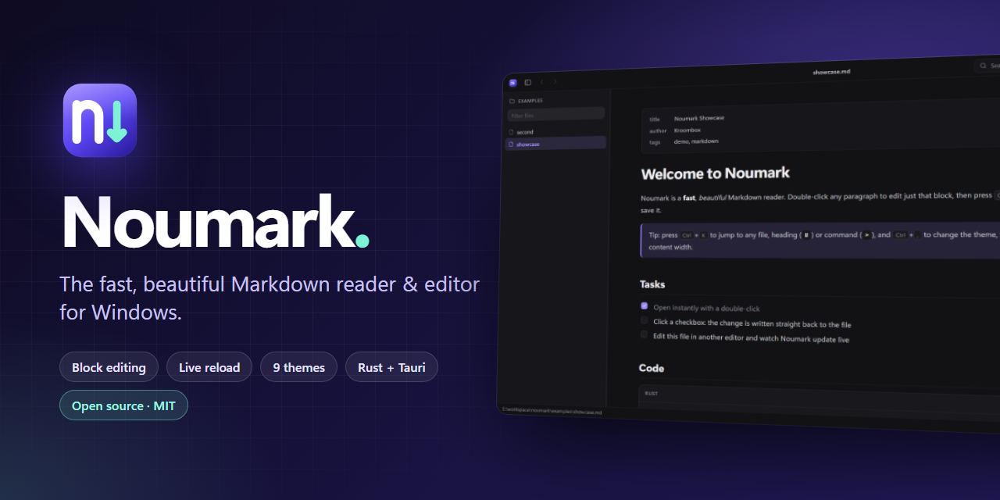
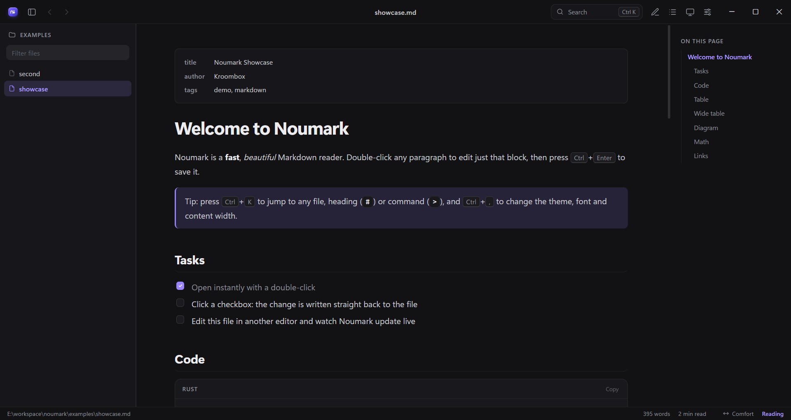
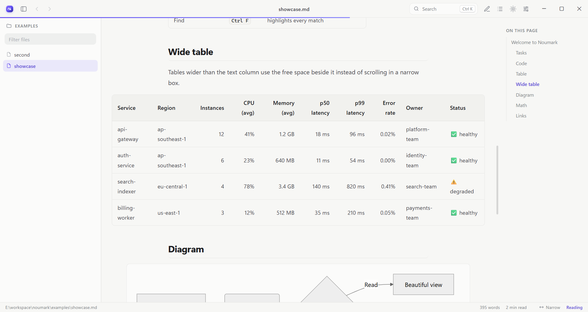
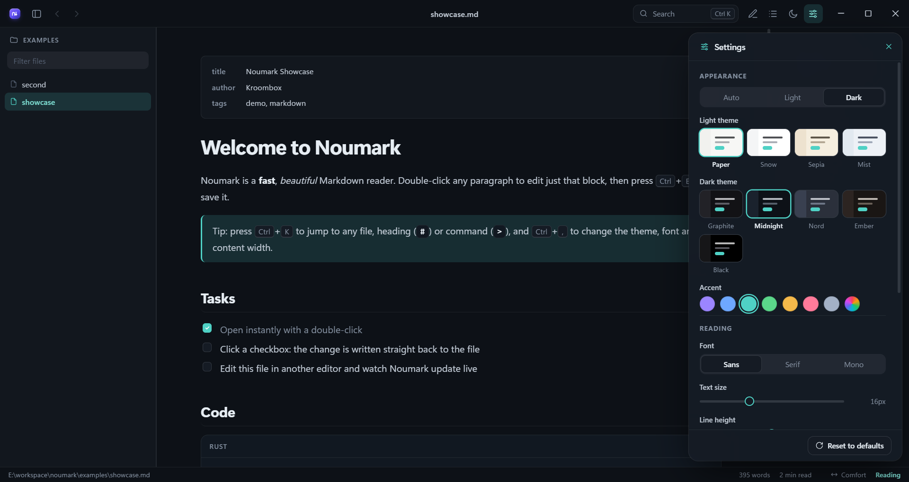

<div align="center">



# Noumark

**A fast, beautiful Markdown reader & editor for Windows.**

Double-click any `.md` file to read it with clean typography, then edit it in place. Live reload keeps it in sync with the file on disk.
Built with Rust and [Tauri 2](https://tauri.app).

[](https://github.com/BBguss/noumark/actions/workflows/ci.yml)
[](https://github.com/BBguss/noumark/releases)
[](LICENSE)


[Download](https://github.com/BBguss/noumark/releases/latest) ·
[User guide](docs/user-guide.md) ·
[Shortcuts](docs/keyboard-shortcuts.md) ·
[Themes & layout](docs/themes-and-layout.md) ·
[Build from source](docs/building.md)



</div>

---

## Why Noumark?

Most of the time you only want to *read* a README, a changelog or a design note, and then maybe fix a typo.
Opening a full IDE for that is slow and heavy. Noumark is built for exactly this moment:

- **Instant.** It's a native window with a small Rust core and the system WebView2, with no bundled browser engine. A single instance is reused, so later files open immediately.
- **Read-first.** Good typography, an outline, reading progress and comfortable widths, so documentation reads like documentation.
- **Edit in place.** Double-click a paragraph, table or code block to edit just that block's Markdown. No mode switch, no separate preview pane.
- **Stays in sync.** If the file changes on disk (from `git pull`, an agent or another editor), the view updates and changed blocks are highlighted.

## Features

| | |
|---|---|
| **Block editing** | Double-click any block to edit its Markdown inline. <kbd>Ctrl</kbd>+<kbd>Enter</kbd> saves, <kbd>Esc</kbd> cancels. |
| **Split editor** | <kbd>Ctrl</kbd>+<kbd>E</kbd> opens a source editor next to a live preview, with autosave. Line endings (CRLF/LF) are preserved. |
| **Interactive tasks** | Click a `- [ ]` checkbox and the change is written back to the file. |
| **Live reload** | External changes are picked up immediately, including atomic "save via rename" writes. |
| **Browser-style navigation** | Relative links to other `.md` files open in place. Use Back/Forward with <kbd>Alt</kbd>+<kbd>←</kbd>/<kbd>→</kbd> or the mouse side buttons. |
| **Command palette** | <kbd>Ctrl</kbd>+<kbd>K</kbd> fuzzy-finds files in the folder or repo, headings (`#`) and commands (`>`). |
| **Themes** | 4 light and 5 dark presets, 7 accent colours plus any custom colour, and Auto/Light/Dark mode. |
| **Adjustable layout** | Narrow → Full content width (or any width from 560 px), resizable sidebar and outline, and wide tables and code that expand into free space. |
| **Typography** | Sans, Serif or Mono reading font, adjustable text size and line height, and zoom. |
| **Rich Markdown** | GFM tables, task lists, footnotes, front matter, syntax highlighting, Mermaid diagrams and KaTeX math. |
| **Focus mode** | <kbd>Ctrl</kbd>+<kbd>.</kbd> dims everything except the block you're reading. |
| **Find** | <kbd>Ctrl</kbd>+<kbd>F</kbd> highlights every match without changing the document. |

<div align="center">


</div>

## Install

1. Download `Noumark_x.y.z_x64-setup.exe` from the [latest release](https://github.com/BBguss/noumark/releases/latest).
2. Run it. It installs for the current user only, so no admin rights are needed.
3. Make Noumark the default app for Markdown. Windows asks you to confirm this once:
   right-click any `.md` file, choose **Open with**, then **Choose another app**, then **Noumark**, then **Always**.
   You can also use the **Set as default** button on the start screen.

A portable `Noumark-portable.exe` is also published with each release. It needs no installation, but it doesn't register file associations.

> **Requirements:** Windows 10 or 11 (x64) with the Microsoft Edge WebView2 runtime. WebView2 is preinstalled on Windows 11, and the installer downloads it on Windows 10 if it's missing.

## Keyboard shortcuts

| Action | Shortcut |
|---|---|
| Command palette (files · `#` headings · `>` commands) | <kbd>Ctrl</kbd>+<kbd>K</kbd> |
| Open file | <kbd>Ctrl</kbd>+<kbd>O</kbd> |
| Toggle source editor | <kbd>Ctrl</kbd>+<kbd>E</kbd> |
| Settings (themes, fonts, width) | <kbd>Ctrl</kbd>+<kbd>,</kbd> |
| Narrower / wider content | <kbd>Ctrl</kbd>+<kbd>[</kbd> / <kbd>Ctrl</kbd>+<kbd>]</kbd> |
| Cycle Auto / Light / Dark | <kbd>Ctrl</kbd>+<kbd>T</kbd> |
| Files sidebar / Outline | <kbd>Ctrl</kbd>+<kbd>B</kbd> / <kbd>Ctrl</kbd>+<kbd>\\</kbd> |
| Find | <kbd>Ctrl</kbd>+<kbd>F</kbd> |
| Focus mode | <kbd>Ctrl</kbd>+<kbd>.</kbd> |
| Back / Forward | <kbd>Alt</kbd>+<kbd>←</kbd> / <kbd>Alt</kbd>+<kbd>→</kbd> |

See [docs/keyboard-shortcuts.md](docs/keyboard-shortcuts.md) for the full list.

## Build from source

You need Node.js 20+, a stable Rust toolchain and the [Tauri prerequisites](https://tauri.app/start/prerequisites/) for Windows.

```powershell
git clone https://github.com/BBguss/noumark.git
cd noumark
npm ci
npm run tauri dev      # run with hot reload
npm run tauri build    # produces the NSIS installer in src-tauri/target/release/bundle/nsis
```

You can also cross-compile the Windows installer from Linux. [docs/building.md](docs/building.md) covers both paths.

## Documentation

- [User guide](docs/user-guide.md): reading, editing, navigation and files
- [Keyboard shortcuts](docs/keyboard-shortcuts.md)
- [Themes & layout](docs/themes-and-layout.md): presets, accents, fonts, widths, and how to add a theme
- [Building](docs/building.md): native Windows build, Linux cross-compile, releases
- [Architecture](docs/architecture.md): how the Rust core and the frontend fit together
- [Troubleshooting](docs/troubleshooting.md)

## Project structure

```
noumark/
├─ index.html            app shell (title bar, panels, palette, settings)
├─ src/
│  ├─ main.js            UI logic: files, editing, navigation, palette, settings
│  ├─ md.js              Markdown pipeline (markdown-it + plugins, sanitising)
│  ├─ theme.js           theme presets, accents, width presets
│  ├─ icons.js           inline SVG icon set
│  └─ style.css          design tokens and all styles
├─ src-tauri/
│  ├─ src/main.rs        window lifecycle, file I/O, watcher, single instance
│  ├─ tauri.conf.json    window, security (CSP) and installer configuration
│  └─ capabilities/      the permissions granted to the frontend
├─ examples/             sample documents that show every feature
├─ docs/                 documentation
└─ scripts/              build helpers
```

## Contributing

Contributions are welcome: bug reports, ideas, themes, docs and code.
Please read [CONTRIBUTING.md](CONTRIBUTING.md) and our [Code of Conduct](CODE_OF_CONDUCT.md) before opening a pull request.
To report a security issue, follow [SECURITY.md](SECURITY.md) and don't open a public issue.

## Acknowledgements

Noumark builds on excellent open-source work: [Tauri](https://tauri.app), [markdown-it](https://github.com/markdown-it/markdown-it),
[highlight.js](https://highlightjs.org), [KaTeX](https://katex.org), [Mermaid](https://mermaid.js.org),
[DOMPurify](https://github.com/cure53/DOMPurify) and [notify](https://github.com/notify-rs/notify).

## License

[MIT](LICENSE) © 2026 Bbguss
