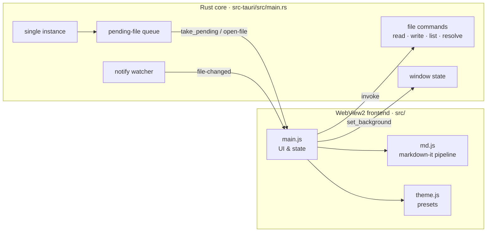

# Architecture

Noumark is deliberately small. There are two moving parts:

## Rust core (`src-tauri/src/main.rs`)

The core owns everything that touches the operating system.

| Concern | How it works |
|---|---|
| **Single instance** | `tauri-plugin-single-instance` forwards the arguments of a second launch to the running app. The path is sent to the frontend as an `open-file` event. If the frontend isn't ready yet, the path is queued instead. |
| **Startup queue** | Files opened while the app is still starting are kept in `AppState.pending`. The frontend calls `take_pending` once its listeners are registered. After that, paths are emitted directly. No file is lost, however early it arrives. |
| **Window visibility** | The window is created hidden and shown from Rust when WebView2 finishes loading the page (`on_page_load`). It doesn't depend on frontend JavaScript succeeding. A watchdog thread shows it after 6 s as a last resort. |
| **Window state** | Size, position, maximised state and the theme's background colour are saved to `%APPDATA%\<identifier>\window.json` on close. They're applied to the window *configuration before the window is created*, so the first frame already has the right size and colour, with no resize or white flash. Off-screen positions are corrected. |
| **File I/O** | `read_file`, `write_file`, `list_markdown`, `workspace_root` and `resolve_link` are `async` commands, so they run on a worker thread and never block the window's message loop. |
| **Watching** | `watch_file` watches the file's *parent directory* (non-recursive) and filters by name. Editors that save by writing a temp file and renaming it are still detected. |
| **External opening** | `open_external` and `reveal` hand URLs and paths to Explorer, with an allow-list of schemes. |

## Frontend (`src/`)

Plain ES modules bundled by Vite, with no UI framework, to keep startup fast and the code easy to follow.

### `md.js`: the rendering pipeline

`render(source)` returns `{ html, toc, words }`:

1. **markdown-it** parses the source with footnotes, KaTeX math (`markdown-it-texmath`) and highlight.js.
2. A custom core rule adds `data-src="start:end"` (source line range) to every top-level block. This mapping powers block editing and change highlighting. It also gives headings stable ids for the outline, and turns `[ ]` / `[x]` into checkboxes that carry their source line.
3. Front matter is rendered as a metadata card. Its lines are blanked rather than removed, so line numbers stay aligned with the file.
4. The HTML is sanitised with **DOMPurify** before it reaches the DOM.

Mermaid is imported lazily, only when a document contains a diagram.

### `main.js`: UI and state

- **State** is a single object: the current path, source text, line-ending style, history stacks, mode and so on. Preferences are a separate object persisted to `localStorage` under the `noumark.` prefix.
- **Block editing** replaces one rendered block with a textarea that holds `lines[start:end]`. When you commit, it splices the edited lines back into the source, saves and re-renders.
- **Saving** is debounced (600 ms in the source editor, immediate for block edits and checkboxes) and restores the file's original CRLF/LF line endings.
- **Live reload** compares the file on disk with the in-memory source. It defers while a save or block edit is pending, so an external change never clobbers your typing. Blocks whose text changed get a `flash` class.
- **Layout.** CSS grid with `--side-w`, `--content-w` and `--toc-w` custom properties. `fitWide()` measures tables, code blocks and diagrams that overflow the text column and widens them, centred on the column, up to the visible width. It runs again on resize through a `ResizeObserver`.

### `theme.js` and `style.css`: theming

A theme preset defines eight base colours. `applyPalette()` writes them as CSS custom properties on `:root`. Every other colour (borders, hovers, panels, accent tints, glows) is derived in `style.css` with `color-mix()`, so presets and custom accent colours always produce a coherent palette. The window background colour is also sent to Rust (`set_background`), so the next launch paints the native window in the theme colour before the page loads.

## Security boundaries

See [SECURITY.md](../SECURITY.md#security-model). In short, rendered HTML is sanitised, the CSP forbids inline scripts, IPC is limited to the listed commands and capabilities, and external opening is allow-listed.

## Performance notes

- No bundled browser engine: WebView2 is shared with the OS.
- The Rust release profile uses LTO, `opt-level = "s"`, `panic = "abort"` and symbol stripping.
- The first document renders before the sidebar is populated. The folder scan runs in the background (`loadTree`), and it skips `node_modules`, `target`, `dist` and similar folders. It's capped at 3,000 files and a depth of 6.
- Mermaid (the largest dependency) is code-split and loaded only when needed.
