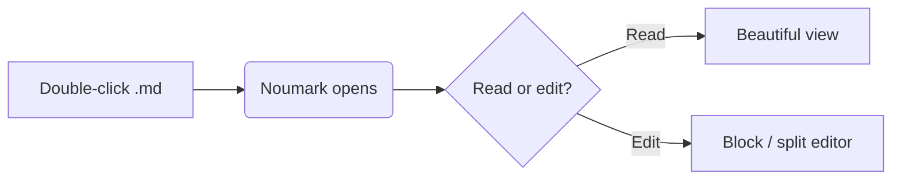

# Welcome to Noumark

Noumark is a **fast**, *beautiful* Markdown reader. Select any text to format it in place with the toolbar, even inside a table cell. <kbd>Ctrl</kbd>+<kbd>Z</kbd> undoes.

> Tip: press <kbd>Ctrl</kbd>+<kbd>K</kbd> to jump to any file, heading (`#`) or command (`>`), and <kbd>Ctrl</kbd>+<kbd>,</kbd> to change the theme, font and content width.

## Tasks

- [x] Open instantly with a double-click
- [ ] Click a checkbox: the change is written straight back to the file
- [ ] Edit this file in another editor and watch Noumark update live

## Code

```rust
fn main() {
    let greeting = "Hello, Noumark";
    println!("{greeting}");
}
```

```powershell
Get-ChildItem -Recurse -Filter *.md | Measure-Object
```

## Table

| Feature         | Shortcut  | Notes                                 |
| --------------- | --------- | ------------------------------------- |
| Command palette | `Ctrl K`  | files, headings, commands             |
| Edit source     | `Ctrl E`  | split view, autosave                  |
| Settings        | `Ctrl ,`  | themes, accent, font, width           |
| Content width   | `Ctrl [ ]`| narrower / wider                      |
| Focus mode      | `Ctrl .`  | dims everything but the current block |
| Find            | `Ctrl F`  | highlights every match                |

## Wide table

Tables wider than the text column use the free space beside it instead of scrolling in a narrow box.

| Service        | Region         | Instances | CPU (avg) | Memory (avg) | p50 latency | p99 latency | Error rate | Owner          | Status       |
| -------------- | -------------- | --------: | --------: | -----------: | ----------: | ----------: | ---------: | -------------- | ------------ |
| api-gateway    | ap-southeast-1 |        12 |       41% |       1.2 GB |       18 ms |       96 ms |      0.02% | platform-team  | ✅ healthy   |
| auth-service   | ap-southeast-1 |         6 |       23% |       640 MB |       11 ms |       54 ms |      0.00% | identity-team  | ✅ healthy   |
| search-indexer | eu-central-1   |         4 |       78% |       3.4 GB |      140 ms |      820 ms |      0.41% | search-team    | ⚠️ degraded  |
| billing-worker | us-east-1      |         3 |       12% |       512 MB |       35 ms |      210 ms |      0.05% | payments-team  | ✅ healthy   |

## Diagram



## Math

Inline math like $E = mc^2$ and display math:

$$
\int_0^\infty e^{-x^2}\,dx = \frac{\sqrt{\pi}}{2}
$$

## Links

- [Back to the top](#welcome-to-noumark)
- [Another document](./second.md)
- [Tauri website](https://tauri.app)

Footnotes work too.[^1]

[^1]: Rendered at the bottom of the document.
